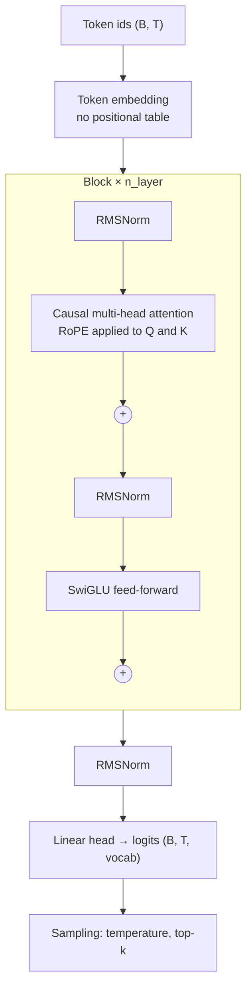

# nanoGPT → Llama: a Modern "Let's build GPT" from Scratch

A decoder-only Transformer language model written from scratch in PyTorch. It starts from the GPT-2-style model in Andrej Karpathy's series ["Let's build GPT"](https://www.youtube.com/watch?v=kCc8FmEb1nY) and replaces its outdated components with the ones used in current Llama-style models: **RMSNorm** instead of LayerNorm, **RoPE** instead of learned positional embeddings, and a **SwiGLU** feed-forward layer instead of the classic two-layer MLP.

Every component is implemented by hand and tied to the paper, section and equation it comes from. Attention uses neither `torch.nn.Transformer` nor `nn.MultiheadAttention` nor `scaled_dot_product_attention`.

## Overview

Karpathy's nanoGPT is the best-known starting point for understanding GPT, but its architecture follows GPT-2 (2019). Most models released since then, including Llama, Mistral and Qwen, share a set of improvements. This project rebuilds the model step by step and modernises it, so that each change is understood at the level of its equations rather than copied from a library.

The end goal is a direct comparison: **the original nanoGPT from the video vs. this model with all planned improvements** (architecture, KV cache, FlashAttention-style attention), trained on the same data with the same budget.

The project follows my self-study plan:

| Stage | Dates | Scope | Status |
|---|---|---|---|
| **Phase 2, Task 1** | 12–18 Oct 2026 | GPT-2 skeleton in a single `model.py`: multi-head attention, causal mask, scaling, MLP, generation loop | ✅ Implemented |
| **Phase 2, Task 2** | 19–25 Oct 2026 | Modernisation to a Llama-style architecture: RMSNorm, RoPE, SwiGLU | ✅ Implemented |
| Phase 3 | 26 Oct – 8 Nov 2026 | KV cache, FlashAttention-style tiling, INT8 quantization, NVIDIA DLI certificate | Planned |
| Final comparison | after Phase 3 | Original nanoGPT vs. this model with all improvements | Planned |
| Phase 4 | 9 – 22 Nov 2026 | Mechanistic interpretability, scaling laws, certificate #2 | Planned |

## Key Features

- **Attention from scratch**: multi-head causal self-attention with an explicit lower-triangular mask and $1/\sqrt{d_k}$ scaling.
- **RMSNorm**: normalisation by the root mean square only, with no mean subtraction and no bias.
- **Rotary positional embeddings (RoPE)**: positions are encoded by rotating query and key vectors, so attention scores depend on relative distance. There is no positional embedding table.
- **SwiGLU feed-forward**: a gated three-matrix layer with the hidden size reduced by 2/3 to keep the parameter count comparable.
- **Pre-norm residual blocks** and **bias-free linear layers**, as in Llama.
- **Autoregressive generation** with temperature and top-k sampling.
- **Correctness tests** for causality, RoPE's relative-position property and RMSNorm.
- **Single file**: the whole model is in `model.py` (~200 lines).

## Architecture



Each block uses pre-norm residual connections:

```math
x \leftarrow x + \mathrm{Attention}(\mathrm{RMSNorm}(x)), \qquad x \leftarrow x + \mathrm{SwiGLU}(\mathrm{RMSNorm}(x))
```

## What Changed Compared to nanoGPT

| Component | nanoGPT (GPT-2 style, Task 1) | This project (Llama style, Task 2) | Source |
|---|---|---|---|
| Normalisation | LayerNorm (mean and variance, gain and bias) | RMSNorm (RMS only, gain only) | Zhang & Sennrich 2019 |
| Positional information | Learned table `pos_emb[T, C]` added to token embeddings | RoPE: rotation of Q and K inside attention | Su et al. 2021 |
| Feed-forward | `Linear(C, 4C) → ReLU → Linear(4C, C)` | `(SiLU(xW) ⊙ xV) W₂`, hidden size 8/3 · C | Shazeer 2020 |
| Linear layers | With bias | Without bias | Llama |
| Parameters (default config) | 10,788,929 | 10,671,744 | — |

The parameter counts differ by only about 1%, so the two models can be compared on equal terms.

## Components and the Papers Behind Them

### Multi-head causal self-attention
*Phuong & Hutter, "Formal Algorithms for Transformers", Section 5, Algorithm 4 (Attention) and Algorithm 5 (MHAttention); decoder-only architecture: Section 6, Algorithm 10.*

```math
\mathrm{Attention}(Q, K, V) = \mathrm{softmax}\!\left(\frac{QK^\top}{\sqrt{d_k}} + M\right)V,
\qquad M_{ij} = \begin{cases} 0 & j \le i \\ -\infty & j > i \end{cases}
```

The mask $M$ is built from `torch.tril`, so token $i$ can only attend to tokens $0 \dots i$. Heads are split by reshaping `(B, T, C) → (B, n_head, T, head_dim)` and concatenated back after attention.

### RMSNorm
*Zhang & Sennrich, "Root Mean Square Layer Normalization", Section 4, Eq. (4).*

```math
\bar{a}_i = \frac{a_i}{\mathrm{RMS}(\mathbf{a})}\, g_i, \qquad \mathrm{RMS}(\mathbf{a}) = \sqrt{\frac{1}{n}\sum_{i=1}^{n} a_i^2}
```

Compared with LayerNorm (Eq. 2 in the same paper), RMSNorm drops the mean subtraction (re-centring) and the bias, keeping only re-scaling with the learned gain $g$. A small $\varepsilon$ is added under the square root for numerical stability.

### Rotary positional embeddings (RoPE)
*Su et al., "RoFormer: Enhanced Transformer with Rotary Position Embedding", Section 3.2.2, Eq. (14)–(16); efficient implementation: Section 3.4.2, Eq. (34).*

Each pair of coordinates of a query or key vector at position $m$ is rotated by the angle $m\theta_i$:

```math
\begin{pmatrix} x'_{2i-1} \\ x'_{2i} \end{pmatrix} =
\begin{pmatrix} \cos m\theta_i & -\sin m\theta_i \\ \sin m\theta_i & \cos m\theta_i \end{pmatrix}
\begin{pmatrix} x_{2i-1} \\ x_{2i} \end{pmatrix},
\qquad \theta_i = 10000^{-2(i-1)/d}
```

Because rotations compose, the attention score depends only on the relative offset (Eq. 16):

```math
(R_{\Theta,m}\, q)^\top (R_{\Theta,n}\, k) = q^\top R_{\Theta,n-m}\, k
```

The code uses the element-wise form from Eq. (34) instead of building the block-diagonal matrix: `cos`/`sin` tables are precomputed once (`precompute_rope`) and applied to even/odd coordinates (`apply_rope`).

### SwiGLU feed-forward
*Shazeer, "GLU Variants Improve Transformer", Section 2, Eq. (5)–(6).*

```math
\mathrm{FFN}_{\mathrm{SwiGLU}}(x, W, V, W_2) = \big(\mathrm{Swish}_1(xW) \otimes xV\big)\, W_2
```

$\mathrm{Swish}_1$ is SiLU. The gated layer has three weight matrices instead of two, so, as in the paper, the hidden size is reduced by a factor of 2/3: $\tfrac{2}{3}\cdot 4C = \tfrac{8}{3}C$, rounded up to a multiple of 64. With the default $C = 384$ this gives 1024.

### Generation
*Phuong & Hutter, Section 7, Algorithm 14 (DInference).*

At each step the model takes the last `block_size` tokens, divides the final logits by the temperature, optionally keeps only the top-k, and samples the next token. There is no KV cache yet: the whole context is recomputed at every step, which is the starting point for Phase 3.

## Training Setup

The training script uses the same data and default hyperparameters as the final model in Karpathy's video, so the final comparison will be like for like.

| Setting | Value |
|---|---|
| Dataset | Tiny Shakespeare (~1.1M characters), downloaded automatically |
| Tokenizer | Character-level, 65 symbols |
| Train / validation split | 90% / 10% |
| Context length (`block_size`) | 256 |
| Layers / heads / embedding size | 6 / 6 / 384 |
| Dropout | 0.2 |
| Batch size | 64 |
| Optimizer | AdamW, learning rate 3e-4 |
| Iterations | 5000 |

## Evaluation Plan

Training and evaluation are deliberately postponed until all planned improvements are in place, so that the comparison shows their combined effect rather than an intermediate version.

| Metric | Original nanoGPT ([`gpt.py`](https://github.com/karpathy/ng-video-lecture)) | This model, all improvements |
|---|---|---|
| Validation loss after 5000 iterations | to be measured (≈ 1.48 reported in the video) | to be measured |
| Training time per iteration | to be measured | to be measured |
| Generation speed (tokens/s) | to be measured | to be measured (with KV cache) |
| Peak memory during attention | to be measured | to be measured (with tiled attention) |

Both models will be run on the same machine (MacBook Pro, Apple M4 Pro, MPS) with the same seed and data split.

## Tests

`test_model.py` checks the properties that are easy to get wrong when implementing these components by hand:

| Test | What it verifies |
|---|---|
| `test_causal_mask_future_tokens_do_not_leak` | Changing a future token does not change the outputs at earlier positions |
| `test_rope_depends_only_on_relative_position` | $\langle R_m q, R_n k\rangle = \langle R_{m+s} q, R_{n+s} k\rangle$ (Eq. 16) |
| `test_rope_preserves_norm_and_is_identity_at_position_zero` | RoPE is a pure rotation: vector length unchanged, no change at position 0 |
| `test_rmsnorm_matches_formula` | Output matches Eq. (4) |
| `test_forward_shapes_and_loss` | Logits have shape `(B, T, vocab)` and the loss is finite |
| `test_generate_appends_tokens_beyond_block_size` | Generation works past the context length (cropping to `block_size`) |

## Project Structure

```text
nanogpt-llama-from-scratch/
├── model.py           # the whole model: RMSNorm, RoPE, attention, SwiGLU, Transformer, generate()
├── train.py           # character-level training on Tiny Shakespeare
├── sample.py          # text generation from a saved checkpoint
├── test_model.py      # correctness tests
├── requirements.txt
├── data/              # Tiny Shakespeare (downloaded on first run, git-ignored)
└── checkpoints/       # saved models (git-ignored)
```

## Setup and Usage

```bash
python3 -m venv .venv
source .venv/bin/activate
pip install -r requirements.txt

python -m pytest -q                                    # correctness tests
python train.py                                        # full training; uses CUDA, Apple MPS or CPU automatically
python train.py --max-iters 500 --eval-interval 100    # short run
python sample.py --prompt "ROMEO:" --max-new-tokens 500 --temperature 0.8 --top-k 40
```

All hyperparameters can be changed from the command line (`python train.py --help`). On a MacBook Pro with M4 Pro, the first evaluation step alone (400 batches) takes about 100 seconds, so a full 5000-iteration run takes on the order of an hour. Use `caffeinate -i python train.py` to keep the Mac awake.

## Limitations

- **Character-level tokenizer and a small dataset**, so the model learns the style of Shakespeare, not the language itself.
- **No KV cache yet**: generation recomputes attention for the whole context at every step (Phase 3, Task 1).
- **Naive attention**: the full $T \times T$ attention matrix is materialised in memory (Phase 3, Task 2).
- **Minimal training loop**: no learning-rate schedule, gradient clipping or mixed precision, kept intentionally close to the video for comparability.
- **Multi-head attention only**: grouped-query attention (GQA), used by larger Llama models, is not implemented.

## Rest of the Plan

### Phase 3: GPU memory, inference and NVIDIA certificate (26 Oct – 8 Nov 2026)

- [ ] **KV cache.** Store keys and values of previous tokens during generation so each new step costs $O(T)$ instead of recomputing the whole context; measure time and memory. Sources: EleutherAI, *Transformer Math 101* (memory formulas for KV states); Phuong & Hutter, Algorithm 14 as the baseline inference loop that the cache optimises (the paper itself does not cover caching).
- [ ] **Online softmax and tiling (FlashAttention).** Compute softmax block by block with running maximum and normaliser updates, without materialising the full $T \times T$ matrix. Source: Dao et al., *FlashAttention* (arXiv:2205.14135), Section 3, Algorithm 1.
- [ ] **INT8 weight quantization.** Outlier features and mixed-precision decomposition into FP16 and INT8 parts. Source: Dettmers et al., *LLM.int8()* (arXiv:2208.07339), Section 3.
- [ ] **Certificate #1:** NVIDIA Deep Learning Institute course on accelerated computing / model parallelism (Megatron-LM).

### Final comparison (after Phase 3)

- [ ] Run the test suite.
- [ ] Train the original nanoGPT (`gpt.py` from the video) and this model with the same data, seed and iteration budget.
- [ ] Fill in the [Evaluation Plan](#evaluation-plan) table and add generated samples from both models.

### Phase 4: Interpretability, scaling laws and certificate #2 (9 – 22 Nov 2026)

- [ ] **Mechanistic interpretability.** Forward hooks on intermediate layers: logit lens, feature directions in weight matrices, variance of the residual stream across layers. Sources: Elhage et al. (Anthropic), *A Mathematical Framework for Transformer Circuits* and *Toy Models of Superposition*.
- [ ] **Training budget.** Compute the compute-optimal model size for a given FLOPs budget. Source: Hoffmann et al., *Training Compute-Optimal Large Language Models* (Chinchilla, arXiv:2203.15556).
- [ ] **Certificate #2.**

## References

**Implemented (Phase 2):**

1. A. Karpathy, ["Let's build GPT: from scratch, in code, spelled out"](https://www.youtube.com/watch?v=kCc8FmEb1nY) (video), code: [ng-video-lecture](https://github.com/karpathy/ng-video-lecture), [nanoGPT](https://github.com/karpathy/nanoGPT).
2. M. Phuong, M. Hutter, ["Formal Algorithms for Transformers"](https://arxiv.org/abs/2207.09238), 2022. Sections 5–7, Algorithms 4, 5, 10, 14.
3. B. Zhang, R. Sennrich, ["Root Mean Square Layer Normalization"](https://arxiv.org/abs/1910.07467), NeurIPS 2019. Section 4, Eq. (4).
4. J. Su et al., ["RoFormer: Enhanced Transformer with Rotary Position Embedding"](https://arxiv.org/abs/2104.09864), 2021. Section 3.2.2, Eq. (14)–(16); Section 3.4.2, Eq. (34).
5. N. Shazeer, ["GLU Variants Improve Transformer"](https://arxiv.org/abs/2002.05202), 2020. Section 2, Eq. (5)–(6).
6. Meta, [`llama/model.py`](https://github.com/meta-llama/llama/blob/main/llama/model.py): reference for tensor shapes and the SwiGLU hidden-size rounding.

**Planned (Phases 3–4):**

7. EleutherAI, ["Transformer Math 101"](https://blog.eleuther.ai/transformer-math/).
8. T. Dao et al., ["FlashAttention: Fast and Memory-Efficient Exact Attention with IO-Awareness"](https://arxiv.org/abs/2205.14135), 2022.
9. T. Dettmers et al., ["LLM.int8(): 8-bit Matrix Multiplication for Transformers at Scale"](https://arxiv.org/abs/2208.07339), 2022.
10. N. Elhage et al., ["A Mathematical Framework for Transformer Circuits"](https://transformer-circuits.pub/2021/framework/index.html), 2021.
11. N. Elhage et al., ["Toy Models of Superposition"](https://transformer-circuits.pub/2022/toy_model/index.html), 2022.
12. J. Hoffmann et al., ["Training Compute-Optimal Large Language Models"](https://arxiv.org/abs/2203.15556), 2022.
